<div align="center">
<picture>
  <source media="(prefers-color-scheme: dark)" srcset=".github/brand/banner-night.svg">
  
</picture>
<br><br>
<a href="#what-it-is"><picture><source media="(prefers-color-scheme: dark)" srcset=".github/brand/tab-what-it-is-night.svg"></picture></a>
<a href="#protocol"><picture><source media="(prefers-color-scheme: dark)" srcset=".github/brand/tab-protocol-night.svg"></picture></a>
<a href="#running-it"><picture><source media="(prefers-color-scheme: dark)" srcset=".github/brand/tab-running-it-night.svg"></picture></a>
</div>

<p>
<a name="what-it-is"></a>
<picture><source media="(prefers-color-scheme: dark)" srcset=".github/brand/section-what-it-is-night.svg"></picture>
</p>

The multiplayer backend for [Frisia](https://github.com/NoamFav/Frisia) (Frisian Draughts). A plain Java `ServerSocket` accepts connections, assigns each client a role — `White`, `Black`, or `Spectator` — and relays a small plain-text protocol between them: `MOVE`, `CHAT`, `READY`, `RESIGN`, `DRAW`, `DISCONNECT`. Deployed on Fly.io.

<p>
<a name="protocol"></a>
<picture><source media="(prefers-color-scheme: dark)" srcset=".github/brand/section-protocol-night.svg"></picture>
</p>

| Command | Effect |
|---------|--------|
| `READY` | Announces the player has joined; broadcasts role to the room |
| `MOVE x,y TO x,y` | Relays a move to the opponent |
| `CHAT <msg>` | Broadcasts a chat message to everyone else |
| `RESIGN` / `DRAW` | Broadcasts the game-ending event |
| `DISCONNECT` | Closes the connection cleanly |

<p>
<a name="running-it"></a>
<picture><source media="(prefers-color-scheme: dark)" srcset=".github/brand/section-running-it-night.svg"></picture>
</p>

```sh
git clone https://github.com/NoamFav/FD-Server && cd FD-Server
mvn compile exec:java -Dexec.mainClass="com.server.MainServer"
# or via Docker
docker build -t fd-server . && docker run -p 9000:9000 fd-server
```

<div align="center">
Made with ♥ by <a href="https://github.com/NoamFav">NoamFav</a>
</div>

<br>

<a href="https://nf-software.com">
<picture>
  <source media="(prefers-color-scheme: dark)" srcset=".github/brand/footer-night.svg">
  
</picture>
</a>
