<div align="center">
<picture>
  <source media="(prefers-color-scheme: dark)" srcset=".github/brand/banner-night.svg">
  
</picture>
<br><br>
<a href="#prerequisites"><picture><source media="(prefers-color-scheme: dark)" srcset=".github/brand/tab-prerequisites-night.svg"></picture></a>
<a href="#installation"><picture><source media="(prefers-color-scheme: dark)" srcset=".github/brand/tab-installation-night.svg"></picture></a>
<a href="#how-to-play"><picture><source media="(prefers-color-scheme: dark)" srcset=".github/brand/tab-how-to-play-night.svg"></picture></a>
<a href="#game-rules"><picture><source media="(prefers-color-scheme: dark)" srcset=".github/brand/tab-game-rules-night.svg"></picture></a>
<a href="#features"><picture><source media="(prefers-color-scheme: dark)" srcset=".github/brand/tab-features-night.svg"></picture></a>
<a href="#contributing"><picture><source media="(prefers-color-scheme: dark)" srcset=".github/brand/tab-contributing-night.svg"></picture></a>
<a href="#license"><picture><source media="(prefers-color-scheme: dark)" srcset=".github/brand/tab-license-night.svg"></picture></a>
</div>

<br>

Frisia is a full-featured implementation of Frisian Draughts built with JavaFX — featuring multiple AI difficulty levels, local multiplayer, interactive tutorials, light/dark themes, and sound effects.

<p>
<a name="prerequisites"></a>
<picture><source media="(prefers-color-scheme: dark)" srcset=".github/brand/section-prerequisites-night.svg"></picture>
</p>

| Requirement | Version |
|-------------|---------|
| Java | 23+ |
| Maven | 3.8+ |
| JavaFX | 22.0.1 (included via Maven) |
| Graphics | OpenGL 2.1+ |

<p>
<a name="installation"></a>
<picture><source media="(prefers-color-scheme: dark)" srcset=".github/brand/section-installation-night.svg"></picture>
</p>

```bash
git clone https://github.com/NoamFav/Frisia.git
cd Frisia
mvn clean javafx:run
```

**Package as installer:**
```bash
mvn clean package -Djpackage.type=dmg    # macOS
mvn clean package -Djpackage.type=exe    # Windows
mvn clean package -Djpackage.type=deb    # Linux
```

<p>
<a name="how-to-play"></a>
<picture><source media="(prefers-color-scheme: dark)" srcset=".github/brand/section-how-to-play-night.svg"></picture>
</p>

| Key | Action |
|-----|--------|
| Mouse click | Select and move pieces |
| Esc | Open game menu |
| M | Toggle sound |
| T | Switch theme (Light/Dark) |
| R | Restart |
| H | Show hint |
| Space | Pause AI thinking |

<p>
<a name="game-rules"></a>
<picture><source media="(prefers-color-scheme: dark)" srcset=".github/brand/section-game-rules-night.svg"></picture>
</p>

Played on a **10×10 board**, dark squares only. Each player starts with **20 pieces**.

- **Pawns** move diagonally forward one square
- **Kings** move diagonally or orthogonally across multiple squares
- Captures are **mandatory** — multi-jump sequences allowed in any direction
- Win by eliminating all opponent pieces or blocking their moves
- Capture priority given to moves with the highest piece value

<p>
<a name="features"></a>
<picture><source media="(prefers-color-scheme: dark)" srcset=".github/brand/section-features-night.svg"></picture>
</p>

- Multiple AI difficulty levels (Minimax + alpha-beta pruning)
- Local multiplayer
- Five interactive tutorial lessons
- Light and dark themes
- Sound effects (toggleable)

<p>
<a name="contributing"></a>
<picture><source media="(prefers-color-scheme: dark)" srcset=".github/brand/section-contributing-night.svg"></picture>
</p>

1. Fork the repository
2. Create your feature branch (`git checkout -b feature/amazing-feature`)
3. Commit your changes and open a Pull Request

<p>
<a name="license"></a>
<picture><source media="(prefers-color-scheme: dark)" srcset=".github/brand/section-license-night.svg"></picture>
</p>

MIT — see [LICENSE](LICENSE).

<div align="center">
Made with ❤️ by <a href="https://github.com/NoamFav">NoamFav</a>
</div>

<br>

<a href="https://nf-software.com">
<picture>
  <source media="(prefers-color-scheme: dark)" srcset=".github/brand/footer-night.svg">
  
</picture>
</a>
